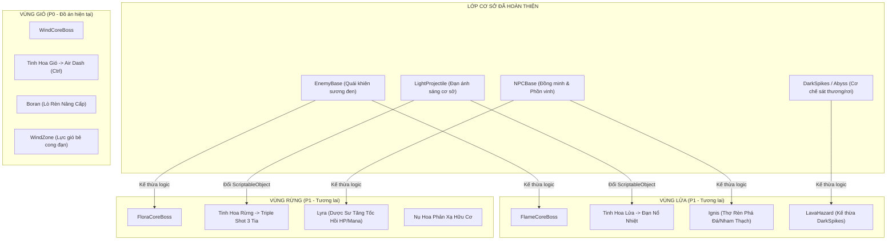

# BÁO CÁO ĐẶC TẢ THIẾT KẾ SCHEMA HỆ THỐNG ĐỐI TƯỢNG (OBJECT SCHEMA SPECIFICATION)
## DỰ ÁN: THE CRADLE OF LIGHT (2D METROIDVANIA PUZZLE ADVENTURE)
**Đơn vị thực hiện:** Team 3009 – DUONG GIA HUY (23127052) & NGUYEN HIEU THUAN (23127125)  
**Tài liệu tham chiếu:** Game Design Document (GDD v0.2)  
**Phạm vi trọng tâm:** Vertical Slice – Vùng Gió (P0) & Khung kiến trúc mở rộng Vùng Lửa/Rừng (P1)  
**Engine:** Unity 2D (URP) | **Ngôn ngữ:** C# (.NET Standard)  

---

# MỤC LỤC
1. [TỔNG QUAN KIẾN TRÚC & PHÂN BỐ CẤU TRÚC FOLDER](#1-tổng-quan-kiến-trúc--phân-bố-cấu-trúc-folder)
   - 1.1 Nguyên lý thiết kế kiến trúc
   - 1.2 Bản đồ thư mục & phân bổ file C# chi tiết trong `GamePJ/Assets`
2. [BẢNG SCHEMA ĐẶC TẢ CHI TIẾT TỪNG COMPONENT](#2-bảng-schema-đặc-tả-chi-tiết-từng-component)
   - 2.1 Nhóm Quản trị Cốt lõi & Lưu trữ (Core Framework & Save System)
   - 2.2 Nhóm Tinh Linh Ánh Sáng (Player Architecture - SRP)
   - 2.3 Nhóm Đạn đạo & Cấu hình Dữ liệu (Projectiles & Combat)
   - 2.4 Nhóm Interfaces & Trừu tượng hóa (Interfaces & Abstractions)
   - 2.5 Nhóm Môi trường, Giải đố & Lối tắt (Environment & Puzzles)
   - 2.6 Nhóm Cạm bẫy & Đạo cụ Sinh thái (Hazards & Environmental Props)
   - 2.7 Nhóm Kẻ địch Bóng tối & Trùm Vùng Gió (Enemy AI & Boss Hierarchy)
   - 2.8 Nhóm NPCs, Kinh tế Lò rèn & Thư viện Lore (NPCs, Economy & Lore)
   - 2.9 Nhóm Giao diện Người dùng (User Interface - UI Systems)
3. [CHIẾN LƯỢC MỞ RỘNG VÙNG LỬA & VÙNG RỪNG (SCALABILITY BLUEPRINT)](#3-chiến-lược-mở-rộng-vùng-lửa--vùng-rừng-scalability-blueprint)
4. [MÃ NGUỒN MERMAID CLASS DIAGRAM TOÀN DIỆN CHO DRAW.IO](#4-mã-nguồn-mermaid-class-diagram-toàn-diện-cho-drawio)
5. [LỘ TRÌNH TRIỂN KHAI & DANH MỤC KIỂM THỬ KỸ THUẬT](#5-lộ-trình-triển-khai--danh-mục-kiểm-thử-kỹ-thuật)

---

# 1. TỔNG QUAN KIẾN TRÚC & PHÂN BỐ CẤU TRÚC FOLDER

## 1.1 Nguyên lý thiết kế kiến trúc
1. **Kiến trúc phân rã trách nhiệm đơn lẻ (Single Responsibility Principle - SRP):**
   - Loại bỏ hoàn toàn mô hình "God Class" trong Unity (tránh việc một file `PlayerController.cs` gánh toàn bộ từ di chuyển, máu, mana, ngắm bắn, tương tác đến UI).
   - Player được tổ chức thành các Module chuyên biệt bọc trong GameObject gốc: `PlayerMovement`, `PlayerCombat`, `PlayerAbilities`, `PlayerStats`, `PlayerInteraction`, và `PlayerLightAura`.
2. **Kiến trúc hướng dữ liệu (Data-Driven with ScriptableObjects):**
   - Tách biệt hoàn toàn chỉ số cân bằng game khỏi mã nguồn logic.
   - Các thuộc tính đạn đạo (`ProjectileDataSO`), thông số nâng cấp lò rèn (`UpgradeItemSO`), mảnh lore ký ức (`MemoryFragmentSO`) và âm thanh (`SoundData`) được cấu hình trực quan trên Unity Editor, cho phép Game Designer tinh chỉnh thông số mà không cần lập trình viên can thiệp biên dịch lại code.
3. **Mô phỏng quang học an toàn (Safe Optical Raycasting with CircleCast):**
   - Đạn ánh sáng bay với vận tốc lớn (16.0 units/s) sẽ sử dụng kỹ thuật quét hình tròn `Physics2D.CircleCast` liên tục theo từng frame thay cho va chạm Collider thông thường nhằm triệt tiêu hoàn toàn lỗi xuyên thủng vật cản (tunneling) qua các khung gương hoặc vách đá mỏng.
   - Tích hợp bộ đếm phản xạ cứng: tối đa 3 lần nảy theo định luật quang học phẳng ($\vec{r} = \vec{d} - 2(\vec{d}\cdot\vec{n})\vec{n}$), tự động kích hoạt nổ diện rộng (AOE) 1.5 units ở lần va chạm thứ 4 để triệt tiêu vĩnh viễn nguy cơ lặp vô hạn giữa 2 gương song song.
4. **Cơ chế thế giới Metroidvania mở khóa bằng kỹ năng (Ability-Gating & Two-Way Persistence):**
   - Toàn bộ các cửa phong ấn (`SealGate`) sau khi giải đố đều mở thông vĩnh viễn 2 chiều, đảm bảo khả năng quay lại khám phá (Backtracking) đặc trưng.
   - Phân định rõ ràng giữa NPC chức năng cốt lõi (Boran - không bao giờ mất, luôn chờ được cứu để mở Lò rèn) và NPC sự kiện (biến mất nếu rời phòng trong lượt chơi).

---

## 1.2 Bản đồ thư mục & phân bổ file C# chi tiết trong `GamePJ/Assets`

```text
GamePJ/Assets/Project/
├── Animations/
│   ├── Enemies/                     # Animator Controllers & Clips cho Crawler, Slime, Weaver, Spitter, Boss
│   └── Player/                      # Animator Controllers & Clips (Idle, Move, Jump, Fall, Launch, Dash, Stun)
├── Art/
│   ├── Enviroment/                  # Spritesheets Tilemap, Gương, Hoa Soi Sáng, Bệ Thờ, Cửa Phong Ấn
│   └── Player/                      # Player.aseprite & Sprite assets
├── Audio/                           # Audio Clips (BGM ambient/hồi sinh, SFX di chuyển, pha lê, hoa nở)
├── Prefabs/
│   ├── Characters/                  # Prefabs: Player, BoranNPC, SacredTreeNPC
│   ├── Enemies/                     # Prefabs: ShadowCrawler, ShadowSlime, ShadowWeaver, ShadowSpitter, WindCoreBoss
│   ├── Environment/                 # Prefabs: ReflectionMirror, RemotePedestal, RadiantBloom, EnergyPylon, 
│   │                                #          SealGate, CheckpointAltar, WindZone, WindShaftShortcut
│   ├── Hazards/                     # Prefabs: DarkSpikes, DarkAbyss, ShadowCage, LoreStele
│   ├── Projectiles/                 # Prefabs: LightProjectile, EnemyThornProjectile
│   └── UI/                          # Prefabs: HUDCanvas, MapCanvas, ForgeShopCanvas, DialogueCanvas
├── Scenes/
│   ├── Prototypes/                  # Cảnh thử nghiệm cơ học
│   ├── LVL01_AwakeningHollow.unity  # Tutorial 5 phòng tuyến tính
│   ├── AREA02_TheCradle_Hub.unity   # Hub Cổ Thụ Ánh Sáng
│   ├── AREA03_WindsThreshold.unity  # Trạm Nghỉ Đầu Gió & Lò Rèn Boran
│   ├── LVL02_WhisperingCaverns.unity# Hẻm Núi Thì Thầm (Cứu Boran, Trục gió Tầng 1)
│   └── LVL03_EyeOfTheTempest.unity  # Đỉnh Gió Gầm (Trục gió Tầng 2, Đấu Boss Lõi Gió)
├── ScriptableObjects/
│   ├── Upgrades/                    # UpgradeItemSO: ManaTank_I, FastRecovery, LightAura, EmpoweredLight...
│   ├── Lore/                        # MemoryFragmentSO: Fragment_01, Fragment_02...
│   ├── Projectiles/                 # ProjectileDataSO: BaseLightBullet, FlameBullet, FloraBullet
│   └── Audio/                       # SoundData: BGM_Ruined, BGM_Purified, SFX_CrystalPing...
└── Scripts/
    ├── Core/
    │   ├── GameManager.cs           # State machine vòng đời game, TimeScale Bullet Time
    │   ├── GameState.cs             # Enum: Boot, MainMenu, Gameplay, BulletTime, Paused, GameOver...
    │   ├── SaveSystem/
    │   │   ├── SaveManager.cs       # Quản lý đọc/ghi JSON cục bộ mã hóa, xử lý 3 save slots
    │   │   ├── GameSaveData.cs      # Lớp dữ liệu lưu trữ trạng thái người chơi & thế giới
    │   │   └── WorldState.cs        # Lưu danh sách cửa đã mở, shortcut, cờ thanh tẩy khu vực
    │   ├── Audio/
    │   │   ├── AudioManager.cs      # Điều phối BGM chuyển trạng thái, SFX 2D spatial, Low-pass filter
    │   │   └── SoundData.cs         # ScriptableObject chứa clip, volume, looping
    │   └── Camera/
    │       ├── CameraFollow2D.cs    # Camera bám theo Tinh linh, Look-ahead theo chuột/hướng chạy
    │       └── CameraZoomController.cs # Dynamic zoom khi vào Bullet Time (10%) hoặc đấu Boss (15%)
    ├── Player/
    │   ├── PlayerController.cs      # Bộ điều phối trung tâm (kết nối Input Actions với các module)
    │   ├── PlayerMovement.cs        # Di chuyển A/D (4.5 u/s), Nhảy Space (12 u/s), Rơi sàn S+Space
    │   ├── PlayerAbilities.cs       # Ground Dash / Air Dash (Ctrl), Launch (Chuột phải, 20 u/s)
    │   ├── PlayerCombat.cs          # Ngắm bắn Chuột trái (Tap/Hold), Bullet Time (0.1x), Hủy ngắm [X]
    │   ├── PlayerStats.cs           # 3 HP / 3 Lives, Mana (100-200), Light Shards (0-999), i-frames 1.5s
    │   ├── PlayerInteraction.cs     # Quét bán kính 1.8 units, kích hoạt White Outline & phím [F]
    │   └── PlayerLightAura.cs       # Quản lý URP 2D Light (bán kính 4.0 - 6.0 units, chớp nháy diegetic)
    ├── Projectiles/
    │   ├── LightProjectile.cs       # Đạn ánh sáng: V=16, nảy max 3 lần, nổ AOE lần 4, chịu lực gió
    │   ├── EnemyProjectile.cs       # Đạn gai đen của Slime/Spitter (bị đạn ánh sáng triệt tiêu)
    │   └── ProjectileDataSO.cs      # ScriptableObject cấu hình đạn đạo
    ├── Environment/
    │   ├── Interfaces/
    │   │   ├── IInteractable.cs     # Interface chung cho vật thể tương tác bấm phím [F]
    │   │   └── IDamageable.cs       # Interface chung cho vật thể nhận sát thương
    │   ├── Puzzles/
    │   │   ├── ReflectionMirror.cs  # Gương: Cố định 45°, Xoay bằng bệ [F], hoặc Tự động xoay liên tục
    │   │   ├── MirrorType.cs        # Enum: Fixed_45Deg, Steerable_Pedestal, AutoRotating_Clockwise
    │   │   ├── RemotePedestal.cs    # Bệ cần xoay trên sàn an toàn, vặn [F] xoay gương 45° qua cáp sáng
    │   │   ├── RadiantBloom.cs      # Hoa Soi Sáng: bắn trúng -> Ánh Sáng Chiếu Rọi 8.0s, hồi sau 5s
    │   │   ├── BloomState.cs        # Enum: Ready, FlareActive, Withered
    │   │   ├── EnergyPylon.cs       # Lõi năng lượng: nhận đạn mở Cửa Phong Ấn (Vĩnh viễn / Hẹn giờ)
    │   │   ├── SealGate.cs          # Cửa đá phong ấn 2 chiều: mở vĩnh viễn, kích hoạt Autosave
    │   │   ├── CheckpointAltar.cs   # Bệ thờ: lướt qua hồi đầy HP/Mana + Save; kẹt >90s hiện [F] Gợi ý
    │   │   ├── WindZone.cs          # Luồng gió: lực đẩy, bẻ cong đạn ánh sáng, chu kỳ gió giật
    │   │   └── WindShaftShortcut.cs # Trục gió liên thông 2 tầng nối thẳng LVL-02 lên LVL-03
    │   └── Hazards/
    │       ├── DarkSpikes.cs        # Bãi gai đen: gây 1 HP sát thương, knockback, tái sinh tại mỏm an toàn
    │       ├── DarkAbyss.cs         # Hố sâu: rơi xuống tự tái sinh tại mỏm an toàn, 0 mất HP (Campaign)
    │       ├── ShadowCage.cs        # Lồng giam đá kẹt NPC: nhận sát thương hoặc giữ [F] 2.0s để phá vỡ
    │       └── LoreStele.cs         # Bia ký ức: tương tác [F] đọc lore và mở khóa Codex Fragment
    ├── Enemies/
    │   ├── Base/
    │   │   ├── EnemyBase.cs         # Lớp cơ sở quái: Máu, Khiên sương đen, Choáng (Stun), Rơi 1-3 LS
    │   │   └── BossBase.cs          # Lớp cơ sở Boss: Máu lớn, Quản lý Phase, Cutscene
    │   ├── AI/
    │   │   ├── ShadowCrawlerAI.cs   # Quái bò tuần tra (2.0 u/s), húc cận chiến, có khiên
    │   │   ├── ShadowSlimeAI.cs     # Quái nhảy bắn xa (1.2 u/s), nén thân 0.5s telegraph, bắn gai đen
    │   │   ├── ShadowWeaverAI.cs    # Nhện phục kích trần nhà, thả dây rơi theo trục Y, bắn tơ
    │   │   └── ShadowSpitterAI.cs   # Pháo đài vách đá cố định, bắn gai đen chu kỳ 2.5s
    │   └── Bosses/
    │       ├── WindCoreBoss.cs      # Lõi Gió Cổ Đại (LVL-03 Boss): Khiên bão, gió xoáy, rơi Zephyr Essence
    │       └── BossPhase.cs         # Enum: Phase1_Shockwaves, Phase2_VortexStorm, Vulnerable_Exposed
    ├── NPC/
    │   ├── Base/
    │   │   ├── NPCBase.cs           # Lớp cơ sở NPC: Quản lý trạng thái, Hộp thoại [F]
    │   │   └── NPCState.cs          # Enum: Trapped, Rescued, Missed
    │   ├── BoranNPC.cs              # Thợ đá Boran: giải cứu tại LVL-02 -> về AREA-03 mở Lò rèn
    │   └── SacredTreeNPC.cs         # Cổ Thụ Ánh Sáng: người dẫn đường tại Hub, đánh giá Phồn Vinh
    ├── Upgrades/
    │   ├── UpgradeItemSO.cs         # ScriptableObject dữ liệu nâng cấp (Cost, Type, Multiplier)
    │   ├── UpgradeType.cs           # Enum: MaxManaTank, FastRecovery, QuickCharge, LightAura...
    │   ├── UpgradeManager.cs        # Xử lý giao dịch mua nâng cấp với Boran bằng Light Shards (LS)
    │   ├── MemoryFragmentSO.cs      # ScriptableObject dữ liệu mảnh ký ức thế giới
    │   └── CodexManager.cs          # Quản lý 12 mảnh ký ức đã thu thập
    └── UI/
        ├── HUDController.cs         # Hiển thị 3 đốm sáng HP, Thanh Mana vạch 20, Đếm LS, Icon gió
        ├── MapUI.cs                 # Room Grid Map (Tab/M): Phòng đã mở, Checkpoint, NPC marker
        ├── ForgeShopUI.cs           # Giao diện mua nâng cấp tại Lò rèn Boran
        ├── DialogueUI.cs            # Khung thoại NPC và nội dung Bia Ký Ức
        └── MainMenuUI.cs            # Continue, New Game (Chọn Slot 1-3, Chọn Mode), Settings, Codex
```

---

# 2. BẢNG SCHEMA ĐẶC TẢ CHI TIẾT TỪNG COMPONENT

Mỗi component dưới đây được định nghĩa đầy đủ theo chuẩn thiết kế phần mềm hướng đối tượng: **Đặc tính dữ liệu (Characteristics / Fields)**, **Hành vi thực thi (Actions / Methods)**, và **Chú thích liên kết chi tiết (Relationship & Dependency Annotations)**.

---

## 2.1 Nhóm Quản trị Cốt lõi & Lưu trữ (Core Framework & Save System)

### 2.1.1 `GameManager`
* **Vị trí file:** `Assets/Project/Scripts/Core/GameManager.cs`
* **Loại:** `MonoBehaviour` (Singleton)
* **Ý nghĩa:** Điều phối trạng thái toàn cục của phiên chơi, quản lý TimeScale (Bullet Time) và luồng sinh tử.

| Phân loại | Tên Định danh | Kiểu / Chữ ký | Giá trị mặc định | Mô tả chi tiết & Chức năng |
| :--- | :--- | :--- | :--- | :--- |
| **Characteristic** | `currentState` | `GameState` | `GameState.Boot` | Trạng thái hiện tại của phiên chơi. |
| **Characteristic** | `saveManager` | `SaveManager` | `null` (Serialized) | Tham chiếu đến hệ thống lưu trữ dữ liệu. |
| **Characteristic** | `audioManager` | `AudioManager` | `null` (Serialized) | Tham chiếu đến hệ thống âm thanh. |
| **Characteristic** | `zoomController` | `CameraZoomController` | `null` (Serialized) | Tham chiếu đến bộ điều khiển Dynamic Zoom camera. |
| **Action** | `ChangeState` | `void (GameState newState)` | N/A | Chuyển đổi trạng thái game, đóng băng/kích hoạt hệ thống tương ứng. |
| **Action** | `SetBulletTime` | `void (bool active)` | N/A | Điều chỉnh `Time.timeScale` thành 0.1x (hoặc 1.0x); kích hoạt bộ lọc âm thanh Low-pass. |
| **Action** | `TriggerGameOver` | `void ()` | N/A | Kích hoạt màn hình Game Over (trong Survival Mode), ép lưu khẩn cấp tọa độ về Hub. |
| **Action** | `TriggerVictory` | `void ()` | N/A | Kích hoạt Cutscene hoàn thành chiến dịch và bảng tổng kết Phồn Vinh. |

* **Chú thích liên kết (Relationships):**
  - **Kế thừa / Thành phần:** Kế thừa `MonoBehaviour`. Chứa tham chiếu cấu thành (`*--`) đến `SaveManager`, `AudioManager` và `CameraZoomController`.
  - **Sự kiện & Điều phối:** Lắng nghe lệnh từ `PlayerCombat` để bật/tắt Bullet Time; nhận thông báo từ `PlayerStats` khi người chơi tử nạn để kích hoạt Respawn hoặc GameOver.

---

### 2.1.2 `SaveManager` & `GameSaveData`
* **Vị trí file:** `Assets/Project/Scripts/Core/SaveSystem/SaveManager.cs` & `GameSaveData.cs`
* **Loại:** `MonoBehaviour` (`SaveManager`) & `[System.Serializable] class` (`GameSaveData`)
* **Ý nghĩa:** Quản lý việc đọc, ghi, mã hóa dữ liệu cục bộ định dạng JSON cho 3 Save Slots độc lập.

| Phân loại | Tên Định danh | Kiểu / Chữ ký | Giá trị mặc định | Mô tả chi tiết & Chức năng |
| :--- | :--- | :--- | :--- | :--- |
| **Characteristic** | `currentData` | `GameSaveData` | New instance | Bộ nhớ đệm lưu dữ liệu phiên chơi hiện hành. |
| **Characteristic** | `savePath` | `string` | PersistentPath | Đường dẫn thư mục lưu tệp `save_slot_{i}.json`. |
| **Characteristic** | `currentData.saveSlotIndex` | `int` | `1` | Chỉ số slot lưu trữ đang chọn (1, 2, hoặc 3). |
| **Characteristic** | `currentData.gameMode` | `string` | `"Campaign"` | Chế độ chơi: `"Campaign"` (3 HP vô hạn mạng) hoặc `"Survival"` (3 Mạng sống). |
| **Characteristic** | `currentData.lastCheckpointPosition`| `Vector3` | `Vector3.zero` | Tọa độ Bệ thờ an toàn gần nhất để Spawn nhân vật khi Load. |
| **Characteristic** | `currentData.openedGateIDs` | `List<string>` | Empty List | Danh sách mã định danh các Cửa Phong Ấn (`SealGate`) đã được mở vĩnh viễn. |
| **Characteristic** | `currentData.unlockedShortcutIDs` | `List<string>` | Empty List | Danh sách mã lối tắt đã kích hoạt (VD: `WindShaft_Tier1`, `WindShaft_Tier2`). |
| **Characteristic** | `currentData.unlockedAbilityIDs` | `List<string>` | Empty List | Danh sách mã kỹ năng đã mở khóa (hệ thống mở: `Ability_Launch`, `Ability_AirDash`...). |
| **Characteristic** | `currentData.rescuedNPCIDs` | `List<string>` | Empty List | Danh sách mã định danh các NPC đã giải cứu (`NPC_Boran`, `NPC_Ignis`, `NPC_Lyra`...). |
| **Action** | `SaveGame` | `void (int slotIndex)` | N/A | Tuần tự hóa `currentData` thành chuỗi JSON và ghi xuống đĩa cục bộ. |
| **Action** | `LoadGame` | `GameSaveData (int slotIndex)` | N/A | Đọc tệp JSON từ đĩa, giải mã và nạp vào `currentData`. |
| **Action** | `TriggerAutosave` | `void ()` | N/A | Kích hoạt lưu game tự động và bắn sự kiện hiển thị biểu tượng đốm sáng xoay trên HUD. |

* **Chú thích liên kết (Relationships):**
  - **Liên kết:** Được gọi trực tiếp bởi `CheckpointAltar` (khi lướt qua), `SealGate` (khi bước qua cửa), `UpgradeManager` (khi mua đồ), và `PlayerStats` (khi cạn 3 mạng ở Survival).
  - **Dữ liệu bền vững:** Đảm bảo toàn bộ câu đố đã giải và đường tắt đã mở không bao giờ bị reset khi người chơi chết hoặc khởi động lại game.

---

### 2.1.3 `AudioManager` & `SoundData`
* **Vị trí file:** `Assets/Project/Scripts/Core/Audio/AudioManager.cs` & `SoundData.cs`
* **Loại:** `MonoBehaviour` (`AudioManager`) & `ScriptableObject` (`SoundData`)
* **Ý nghĩa:** Quản lý âm thanh không gian 2D, chuyển biến BGM theo trạng thái thanh tẩy thế giới và hiệu ứng làm trầm (Low-pass Filter) trong Bullet Time.

| Phân loại | Tên Định danh | Kiểu / Chữ ký | Giá trị mặc định | Mô tả chi tiết & Chức năng |
| :--- | :--- | :--- | :--- | :--- |
| **Characteristic** | `bgmSource` | `AudioSource` | `null` | Kênh phát nhạc nền chính (BGM). |
| **Characteristic** | `sfxSource` | `AudioSource` | `null` | Kênh phát hiệu ứng tương tác tức thì (SFX). |
| **Characteristic** | `lowPassFilter` | `AudioLowPassFilter` | `null` | Bộ lọc dải tần cao dùng cho trạng thái ngưng đọng thời gian. |
| **Characteristic** | `SoundData.soundID` | `string` | `""` | Tên mã định danh của âm thanh (VD: `"SFX_CrystalPing"`). |
| **Characteristic** | `SoundData.clip` | `AudioClip` | `null` | Tệp âm thanh gốc. |
| **Characteristic** | `SoundData.volume` | `float` | `1.0f` | Âm lượng chuẩn của tệp. |
| **Action** | `PlayBGM` | `void (SoundData data)` | N/A | Phát nhạc nền với hiệu ứng Fade-in mượt mà trong 2.0s. |
| **Action** | `PlaySFX` | `void (SoundData data)` | N/A | Phát âm thanh tương tác theo chuẩn 2D Spatial Panning. |
| **Action** | `SetLowPassFilter` | `void (bool active)` | N/A | Giảm 50% âm lượng BGM và lọc dải tần cao khi Bullet Time bật. |

---

### 2.1.4 `CameraFollow2D` & `CameraZoomController`
* **Vị trí file:** `Assets/Project/Scripts/Core/Camera/CameraFollow2D.cs` & `CameraZoomController.cs`
* **Loại:** `MonoBehaviour`
* **Ý nghĩa:** Điều khiển góc nhìn 2D bám theo Tinh linh, tự động nhìn trước (Look-ahead) và phóng to/thu nhỏ khung hình theo bối cảnh.

| Phân loại | Tên Định danh | Kiểu / Chữ ký | Giá trị mặc định | Mô tả chi tiết & Chức năng |
| :--- | :--- | :--- | :--- | :--- |
| **Characteristic** | `targetPlayer` | `Transform` | `null` | Transform của nhân vật Tinh linh. |
| **Characteristic** | `smoothSpeed` | `float` | `0.125f` | Độ trễ làm mượt chuyển động theo dõi (Smooth Damping). |
| **Characteristic** | `lookAheadOffset` | `Vector2` | `(1.5f, 0.5f)` | Độ lệch khung hình nhìn trước theo hướng di chuyển hoặc con trỏ chuột. |
| **Characteristic** | `baseOrthoSize` | `float` | `5.0f` | Độ bao quát camera tiêu chuẩn trong chế độ 2D Orthographic. |
| **Action** | `FollowUpdate` | `void ()` | N/A | Cập nhật vị trí camera trong `LateUpdate()`. |
| **Action** | `ZoomBulletTime` | `void (bool inBulletTime)`| N/A | Phóng to 10% (OrthoSize giảm còn 4.5) để tăng độ tập trung ngắm bắn. |
| **Action** | `ZoomBossArena` | `void (bool inArena)` | N/A | Thu nhỏ 15% (OrthoSize tăng lên 5.75) để bao quát đấu trường Boss. |

---

## 2.2 Nhóm Tinh Linh Ánh Sáng (Player Architecture - SRP)

### 2.2.1 `PlayerStats`
* **Vị trí file:** `Assets/Project/Scripts/Player/PlayerStats.cs`
* **Loại:** `MonoBehaviour`
* **Ý nghĩa:** Quản lý sinh mệnh (HP/Mạng), tài nguyên Năng Lượng Ánh Sáng (Mana), tiền tệ Mảnh Sáng (LS) và trạng thái bất tử (i-frames).

| Phân loại | Tên Định danh | Kiểu / Chữ ký | Giá trị mặc định | Mô tả chi tiết & Chức năng |
| :--- | :--- | :--- | :--- | :--- |
| **Characteristic** | `currentHealth` | `int` | `3` | Sinh mệnh hiện tại (3 HP trong Campaign hoặc 3 Lives trong Survival). |
| **Characteristic** | `maxHealth` | `int` | `3` | Sinh mệnh tối đa. |
| **Characteristic** | `currentMana` | `float` | `100.0f` | Năng lượng hiện tại dùng để tạo và bắn đạn (0 - 100 điểm). |
| **Characteristic** | `maxMana` | `float` | `100.0f` | Dung lượng Mana tối đa (nâng cấp lên 125, 150, 200 tại Lò rèn). |
| **Characteristic** | `lightShards` | `int` | `0` | Tiền tệ Mảnh Năng Lượng Ánh Sáng thu thập được (tối đa 999 LS). |
| **Characteristic** | `isInvulnerable`| `bool` | `false` | Cờ bất tử tạm thời sau khi chịu sát thương. |
| **Characteristic** | `iFrameTimer` | `float` | `1.5f` | Thời lượng bất tử miễn nhiễm đòn (1.5s kèm chớp trắng). |
| **Characteristic** | `lastSafeGroundedPos`| `Vector2` | `Vector2.zero` | Tọa độ mỏm đất an toàn gần nhất trước khi xảy ra va chạm/rơi hố. |
| **Action** | `TakeDamage` | `void (int dmg, Vector2 sourcePos)`| N/A | Trừ 1 HP, tạo lực giật lùi (knockback 0.2s), kích hoạt 1.5s i-frames. |
| **Action** | `FallIntoAbyss` | `void ()` | N/A | Xử lý rơi hố sâu: Campaign mode tái tạo tức thì tại `lastSafeGroundedPos` (0 trừ HP); Survival mode trừ 1 Mạng. |
| **Action** | `ConsumeMana` | `bool (float amount)` | N/A | Tiêu hao Mana nếu đủ ($\ge 20$), trả về `true`; nếu thiếu trả về `false` kèm tiếng buzz. |
| **Action** | `AddLightShards`| `void (int amount)` | N/A | Tăng tiền tệ LS (giới hạn tối đa 999), cập nhật HUD. |
| **Action** | `RestoreFullStats`| `void ()` | N/A | Hồi phục tức thì 100% HP và 100% Mana (dùng khi chạm Checkpoint). |

* **Chú thích liên kết (Relationships):**
  - **Sự kiện xuất ra (Events):** `OnHealthChanged(int current, int max)`, `OnManaChanged(float current, float max)`, `OnShardsChanged(int amount)`, `OnPlayerDied()`.
  - **Người nghe (Listeners):** `HUDController` cập nhật giao diện; `PlayerLightAura` kích hoạt chớp nháy cảnh báo; `GameManager` nhận diện cái chết.

---

### 2.2.2 `PlayerMovement`
* **Vị trí file:** `Assets/Project/Scripts/Player/PlayerMovement.cs`
* **Loại:** `MonoBehaviour`
* **Ý nghĩa:** Điều khiển các chuyển động nền tảng cơ sở 2D: di chuyển ngang bám đất, nhảy cơ bản, rơi lọt tầng sàn mềm và thời gian đệm Coyote Time.

| Phân loại | Tên Định danh | Kiểu / Chữ ký | Giá trị mặc định | Mô tả chi tiết & Chức năng |
| :--- | :--- | :--- | :--- | :--- |
| **Characteristic** | `moveSpeed` | `float` | `4.5f` | Tốc độ di chuyển ngang tối đa (units/s). |
| **Characteristic** | `accelTime` | `float` | `0.15f` | Thời gian đạt vận tốc tối đa từ trạng thái đứng yên. |
| **Characteristic** | `decelTime` | `float` | `0.10f` | Thời gian ma sát dừng trượt hoàn toàn. |
| **Characteristic** | `jumpForce` | `float` | `12.0f` | Xung lực đẩy thẳng đứng khi nhấn Space (đạt độ cao max 2.88 units). |
| **Characteristic** | `gravity` | `float` | `25.0f` | Gia tốc trọng lực cơ sở của thế giới ($g = 25.0\text{ units/s}^2$). |
| **Characteristic** | `isGrounded` | `bool` | `true` | Cờ trạng thái nhân vật đang tiếp xúc với mặt đất. |
| **Characteristic** | `coyoteTimer` | `float` | `0.1f` | Thời gian đệm cho phép nhảy sau khi vừa rời khỏi mép vực (0.1s). |
| **Action** | `Move` | `void (Vector2 input)` | N/A | Nhận input từ A/D hoặc Mũi tên, áp vận tốc lên Rigidbody2D. |
| **Action** | `Jump` | `void ()` | N/A | Tạo xung lực nhảy nếu `isGrounded == true` hoặc `coyoteTimer > 0`. |
| **Action** | `DropThroughPlatform`| `void ()` | N/A | Bỏ qua va chạm với sàn một chiều (One-way Platform) trong 0.3s khi bấm S + Space. |
| **Action** | `SetMovementLock`| `void (bool isLocked)`| N/A | Khóa chuyển động ngang A/D (dùng khi vào Bullet Time hoặc dính Stun). |

---

### 2.2.3 `PlayerAbilities`
* **Vị trí file:** `Assets/Project/Scripts/Player/PlayerAbilities.cs`
* **Loại:** `MonoBehaviour`
* **Ý nghĩa:** Điều khiển các năng lực cơ động nâng cao: Lướt nhanh (Ground/Air Dash bằng phím Ctrl) và Phóng thân thể (Launch bằng Chuột phải).

| Phân loại | Tên Định danh | Kiểu / Chữ ký | Giá trị mặc định | Mô tả chi tiết & Chức năng |
| :--- | :--- | :--- | :--- | :--- |
| **Characteristic** | `unlockedAbilities` | `HashSet<string>`| Empty Set | Tập hợp mã định danh kỹ năng đã mở khóa (`"Ability_Launch"`, `"Ability_AirDash"`...). |
| **Characteristic** | `canAirDash` | `bool` | `true` | Đánh dấu còn lượt Air Dash trên không (tối đa 1 lần / lần nhảy). |
| **Characteristic** | `dashSpeed` | `float` | `13.0f` | Tốc độ lướt ngang khi bấm phím Ctrl (quãng đường ~2.6 units trong 0.2s). |
| **Characteristic** | `dashCooldown` | `float` | `0.6f` | Thời gian hồi chiêu khi lướt trên mặt đất (0.6s). |
| **Characteristic** | `launchSpeed` | `float` | `20.0f` | Tốc độ phóng thân thể theo hướng con trỏ chuột (units/s). |
| **Action** | `HasAbility` | `bool (string abilityID)`| N/A | Kiểm tra xem người chơi đã mở khóa kỹ năng cụ thể hay chưa. |
| **Action** | `UnlockAbility` | `void (string abilityID)`| N/A | Mở khóa kỹ năng mới vào tập hợp và kích hoạt sự kiện lưu/VFX tương ứng. |
| **Action** | `TryExecuteDash` | `void ()` | N/A | Thực hiện Ground Dash (nếu chạm đất) hoặc Air Dash (nếu trên không và `HasAbility("Ability_AirDash")`). |
| **Action** | `TryExecuteLaunch`| `void (Vector2 mousePos)`| N/A | Phóng thân thể theo vector chuột nếu thỏa mãn: `isGrounded == true`, `HasAbility("Ability_Launch")` và không ngắm bắn. |
| **Action** | `ResetAirDash` | `void ()` | N/A | Hồi lại lượt Air Dash duy nhất khi Tinh linh chạm lại mặt đất (`isGrounded == true`). |

---

### 2.2.4 `PlayerCombat`
* **Vị trí file:** `Assets/Project/Scripts/Player/PlayerCombat.cs`
* **Loại:** `MonoBehaviour`
* **Ý nghĩa:** Quản lý cơ chế ngắm bắn Chuột trái (Tap / Hold), trạng thái Bullet Time (0.1x), laser dự báo quỹ đạo và quy tắc hồi phục Mana.

| Phân loại | Tên Định danh | Kiểu / Chữ ký | Giá trị mặc định | Mô tả chi tiết & Chức năng |
| :--- | :--- | :--- | :--- | :--- |
| **Characteristic** | `manaCostPerShot` | `float` | `20.0f` | Chi phí Mana mỗi phát bắn đạn ánh sáng (20 điểm / 20%). |
| **Characteristic** | `bulletTimeScale` | `float` | `0.1f` | Hệ số làm chậm thời gian thế giới khi ngắm (giảm 90%). |
| **Characteristic** | `normalRegenRate` | `float` | `2.0f` | Tốc độ hồi Mana tự nhiên liên tục (2 điểm/s ~ 2%/s). |
| **Characteristic** | `fastRegenRate` | `float` | `25.0f` | Tốc độ hồi Mana tăng tốc sau thời gian chờ (25 điểm/s ~ 25%/s). |
| **Characteristic** | `fastRegenDelay` | `float` | `3.0f` | Thời gian không dùng kỹ năng tốn Mana để kích hoạt hồi nhanh (3.0s). |
| **Characteristic** | `aimHoldThreshold` | `float` | `0.25f` | Ngưỡng thời gian phân biệt giữa Tap nhanh (<0.25s) và Hold giữ (>=0.25s). |
| **Characteristic** | `aimLaser` | `LineRenderer`| `null` | Tia laser hạt sáng hiển thị quỹ đạo bay và điểm nảy dự kiến. |
| **Action** | `StartAimHold` | `void ()` | N/A | Nhấn giữ Chuột trái: Kích hoạt Bullet Time, khóa A/D, trọng lực rơi còn 10%, hiện laser. |
| **Action** | `ReleaseAimFire` | `void ()` | N/A | Nhả Chuột trái: Trừ 20 Mana, phóng đạn ánh sáng theo vector laser, tắt Bullet Time. |
| **Action** | `ExecuteTapAim` | `void ()` | N/A | Nhấn nhanh Chuột trái: Trừ ngay 20 Mana, tạo quả cầu lơ lửng chờ click ngắm bắn (tồn tại 8.0s). |
| **Action** | `CancelAim` | `void ()` | N/A | Nhấn phím [X]: Hủy trạng thái ngắm. Nếu dùng Hold -> không mất Mana; nếu Tap -> không hoàn Mana. |
| **Action** | `UpdateManaRegen` | `void ()` | N/A | Tính toán hồi Mana theo thời gian Game Time (trong Bullet Time hồi chậm 90%). |

---

### 2.2.5 `PlayerInteraction` & `PlayerLightAura`
* **Vị trí file:** `Assets/Project/Scripts/Player/PlayerInteraction.cs` & `PlayerLightAura.cs`
* **Loại:** `MonoBehaviour`
* **Ý nghĩa:** Quét đối tượng tương tác ngữ cảnh trong tầm 1.8 units và điều khiển quầng sáng URP 2D Light.

| Phân loại | Tên Định danh | Kiểu / Chữ ký | Giá trị mặc định | Mô tả chi tiết & Chức năng |
| :--- | :--- | :--- | :--- | :--- |
| **Characteristic** | `interactRadius` | `float` | `1.8f` | Bán kính phát hiện vật thể tương tác quanh Tinh linh (1.8 units). |
| **Characteristic** | `currentTarget` | `IInteractable`| `null` | Đối tượng tương tác hợp lệ gần nhất. |
| **Characteristic** | `baseRadius` | `float` | `4.0f` | Bán kính chiếu sáng cơ bản của Tinh linh (4.0 units). |
| **Characteristic** | `currentRadius` | `float` | `4.0f` | Bán kính thực tế (mở rộng lên 6.0 units sau khi nâng cấp Lò rèn). |
| **Action** | `ScanForInteractables`| `void ()` | N/A | Quét OverlapCircle tìm `IInteractable`; bật viền trắng (White Outline) và hiện icon `[F]`. |
| **Action** | `TriggerInteraction`| `void ()` | N/A | Gọi `currentTarget.Interact()` khi người chơi nhấn phím [F]. |
| **Action** | `TriggerDamageFlicker`| `void ()` | N/A | Kích hoạt hiệu ứng chớp nháy quầng sáng khi Tinh linh nhận sát thương. |

---

## 2.3 Nhóm Đạn đạo & Cấu hình Dữ liệu (Projectiles & Combat)

### 2.3.1 `LightProjectile` & `ProjectileDataSO`
* **Vị trí file:** `Assets/Project/Scripts/Projectiles/LightProjectile.cs` & `ProjectileDataSO.cs`
* **Loại:** `MonoBehaviour` (`LightProjectile`) & `ScriptableObject` (`ProjectileDataSO`)
* **Ý nghĩa:** Thực thể đạn ánh sáng bay tốc độ cao, tương tác quang học phản xạ qua gương, phá khiên kẻ địch và kích hoạt cơ quan.

| Phân loại | Tên Định danh | Kiểu / Chữ ký | Giá trị mặc định | Mô tả chi tiết & Chức năng |
| :--- | :--- | :--- | :--- | :--- |
| **Characteristic** | `speed` | `float` | `16.0f` | Vận tốc bay thẳng của đạn (16.0 units/s). |
| **Characteristic** | `moveDirection` | `Vector2` | `Vector2.zero` | Vector đơn vị hướng bay hiện tại của đạn. |
| **Characteristic** | `bounceCount` | `int` | `0` | Số lần đã phản xạ qua các bề mặt gương phẳng. |
| **Characteristic** | `maxBounces` | `int` | `3` | Giới hạn phản xạ tối đa (3 lần nảy). |
| **Characteristic** | `isEmpowered` | `bool` | `false` | Cờ đạn cường hóa (mua từ Boran): gây 2 Hit, xuyên thủng khiên quái vật. |
| **Characteristic** | `explosionRadius`| `float` | `1.5f` | Bán kính vụ nổ diện rộng ở lần va chạm thứ 4 hoặc khi chạm mục tiêu. |
| **Action** | `Initialize` | `void (Vector2 dir, bool empowered)`| N/A | Khởi tạo hướng bay và đặc tính đạn. |
| **Action** | `Reflect` | `void (Vector2 normal)`| N/A | Tính toán vector phản xạ $\vec{r} = \vec{d} - 2(\vec{d}\cdot\vec{n})\vec{n}$, tăng `bounceCount`. |
| **Action** | `Explode` | `void ()` | N/A | Kích hoạt nổ AOE gây sát thương trong bán kính 1.5 units và hủy đạn. |
| **Action** | `ApplyWindForce` | `void (Vector2 wind)` | N/A | Nhận lực gió từ `WindZone` làm cong quỹ đạo thành đường cong parabol. |

---

### 2.3.2 `EnemyProjectile`
* **Vị trí file:** `Assets/Project/Scripts/Projectiles/EnemyProjectile.cs`
* **Loại:** `MonoBehaviour`
* **Ý nghĩa:** Tia gai đen do quái vật bắn ra (Shadow Slime / Spitter). Có thể bị triệt tiêu nếu va chạm với `LightProjectile` của người chơi.

---

## 2.4 Nhóm Interfaces & Trừu tượng hóa (Interfaces & Abstractions)

### 2.4.1 `IInteractable` & `IDamageable`
* **Vị trí file:** `Assets/Project/Scripts/Environment/Interfaces/`
* **Loại:** `C# Interface`
* **Ý nghĩa:** Cung cấp tính đa hình cho hệ thống tương tác bằng phím [F] và hệ thống tiếp nhận sát thương.

```csharp
public interface IInteractable
{
    void Interact();               // Thực thi hành vi khi bấm phím [F]
    void Highlight(bool state);    // Bật/tắt đường viền phát sáng màu trắng (White Glowing Outline)
}

public interface IDamageable
{
    void TakeDamage(int amount);   // Tiếp nhận sát thương từ đạn ánh sáng
}
```

---

## 2.5 Nhóm Môi trường, Giải đố & Lối tắt (Environment & Puzzles)

### 2.5.1 `ReflectionMirror` & `MirrorType`
* **Vị trí file:** `Assets/Project/Scripts/Environment/Puzzles/ReflectionMirror.cs`
* **Loại:** `MonoBehaviour`
* **Ý nghĩa:** Bề mặt quang học điều hướng đạn ánh sáng theo định luật phản xạ.

| Phân loại | Tên Định danh | Kiểu / Chữ ký | Giá trị mặc định | Mô tả chi tiết & Chức năng |
| :--- | :--- | :--- | :--- | :--- |
| **Characteristic** | `type` | `MirrorType` | `Fixed_45Deg` | Loại gương: Cố định 45°, Xoay bằng Bệ Cần [F], hoặc Tự động xoay liên tục. |
| **Characteristic** | `currentAngle` | `float` | `45.0f` | Góc xoay hiện tại của mặt gương so với phương ngang. |
| **Characteristic** | `autoRotationSpeed`| `float` | `30.0f` | Vận tốc góc tự xoay quanh trục (độ/giây, dành cho gương tự động). |
| **Action** | `RotateStep` | `void (float angle = 45f)`| N/A | Xoay mặt gương thêm 45° theo chiều kim đồng hồ, khóa vào khấc ("khục"). |
| **Action** | `GetNormalVector`| `Vector2 ()` | N/A | Trả về vector pháp tuyến 2D của mặt gương phục vụ tính góc nảy đạn. |
| **Action** | `OnProjectileHit`| `void (LightProjectile p)`| N/A | Phát âm thanh pha lê (Crystal Ping) và tia lóe sao (Hit Flash). |

---

### 2.5.2 `RemotePedestal`
* **Vị trí file:** `Assets/Project/Scripts/Environment/Puzzles/RemotePedestal.cs`
* **Loại:** `MonoBehaviour`, hiện thực hóa `IInteractable`
* **Ý nghĩa:** Cơ quan bệ xoay đặt trên sàn đất an toàn, kết nối với gương trên cao bằng rãnh cáp phát quang.

| Phân loại | Tên Định danh | Kiểu / Chữ ký | Giá trị mặc định | Mô tả chi tiết & Chức năng |
| :--- | :--- | :--- | :--- | :--- |
| **Characteristic** | `linkedMirror` | `ReflectionMirror` | `null` | Chiếc gương treo trên cao được kết nối cơ khí với bệ này. |
| **Characteristic** | `energyCable` | `LineRenderer` | `null` | Rãnh vân năng lượng chạy dọc vách đá nối từ bệ lên gương. |
| **Action** | `Interact` | `void ()` | N/A | Hiện thực `IInteractable`: Bấm [F] vặn cần gạt, gọi `linkedMirror.RotateStep(45f)`. |
| **Action** | `Highlight` | `void (bool state)` | N/A | Hiện thực `IInteractable`: Bật viền sáng trắng và hiển thị icon `[F] Vặn cần xoay`. |

---

### 2.5.3 `RadiantBloom` & `BloomState` (Hoa Soi Sáng)
* **Vị trí file:** `Assets/Project/Scripts/Environment/Puzzles/RadiantBloom.cs`
* **Loại:** `MonoBehaviour`
* **Ý nghĩa:** Đạo cụ thực vật phát quang môi trường. **Tuyệt đối không dùng phím [F]**; kích hoạt duy nhất khi bị bắn trúng bởi Đạn Ánh Sáng.

| Phân loại | Tên Định danh | Kiểu / Chữ ký | Giá trị mặc định | Mô tả chi tiết & Chức năng |
| :--- | :--- | :--- | :--- | :--- |
| **Characteristic** | `state` | `BloomState` | `BloomState.Ready` | Trạng thái: Sẵn sàng (`Ready`), Bừng sáng (`FlareActive`), Héo rũ (`Withered`). |
| **Characteristic** | `flareDuration` | `float` | `8.0f` | Thời lượng hiệu ứng "Ánh Sáng Chiếu Rọi" (tổng cộng 8.0s). |
| **Characteristic** | `rechargeDuration`| `float` | `60.0f` | Thời gian chờ hồi phục từ hoa xám héo rũ về lại trạng thái `Ready` (5.0s). |
| **Characteristic** | `ambientRoomLight`| `Light2D` | `null` | Nguồn sáng toàn cảnh căn phòng. |
| **Action** | `OnHitByLightProjectile`| `void ()` | N/A | Kích hoạt Coroutine chuỗi hiệu ứng 8.0s: 0-1s bùng nổ phơi sáng, 1-6s duy trì rực rỡ, 6-8s khép tối Vignette và héo úa. |

---

### 2.5.4 `EnergyPylon` & `SealGate`
* **Vị trí file:** `Assets/Project/Scripts/Environment/Puzzles/EnergyPylon.cs` & `SealGate.cs`
* **Loại:** `MonoBehaviour`, `EnergyPylon` hiện thực hóa `IDamageable`
* **Ý nghĩa:** Cặp đôi cơ quan tiếp nhận năng lượng và cánh cửa đá phong ấn 2 chiều.

| Phân loại | Tên Định danh | Kiểu / Chữ ký | Giá trị mặc định | Mô tả chi tiết & Chức năng |
| :--- | :--- | :--- | :--- | :--- |
| **Characteristic** | `EnergyPylon.isActive` | `bool` | `false` | Trạng thái lõi đã được kích hoạt bởi đạn ánh sáng. |
| **Characteristic** | `EnergyPylon.isTimed` | `bool` | `false` | Cờ công tắc hẹn giờ (nếu true, đếm ngược 5.0s Game Time rồi đóng lại). |
| **Characteristic** | `EnergyPylon.linkedGate` | `SealGate` | `null` | Cánh cửa phong ấn liên kết với lõi này. |
| **Characteristic** | `SealGate.gateID` | `string` | `""` | Mã định danh cửa (dùng để lưu trạng thái mở vĩnh viễn vào Save file). |
| **Characteristic** | `SealGate.isOpen` | `bool` | `false` | Trạng thái cửa đã mở hay đang khóa. |
| **Action** | `EnergyPylon.TakeDamage` | `void (int amount)`| N/A | Hiện thực `IDamageable`: Nhận đạn ánh sáng, bốc cháy vàng kim, mở `linkedGate`. |
| **Action** | `SealGate.OpenGate` | `void (bool instant)`| N/A | Trượt cửa đá lên trên vĩnh viễn, vô hiệu hóa Collider cản đường. |
| **Action** | `SealGate.OnPlayerPassThrough`| `void ()` | N/A | Kích hoạt Autosave khi người chơi bước qua cửa. |

---

### 2.5.5 `CheckpointAltar`
* **Vị trí file:** `Assets/Project/Scripts/Environment/Interactables/CheckpointAltar.cs`
* **Loại:** `MonoBehaviour`, hiện thực hóa `IInteractable`
* **Ý nghĩa:** Trạm lưu dữ liệu và hồi sức với 2 cơ chế: Thụ động (lướt qua hồi máu/save) và Chủ động (bế tắc >90s hiện [F] đọc gợi ý).

| Phân loại | Tên Định danh | Kiểu / Chữ ký | Giá trị mặc định | Mô tả chi tiết & Chức năng |
| :--- | :--- | :--- | :--- | :--- |
| **Characteristic** | `checkpointID` | `string` | `""` | Mã định danh điểm Checkpoint. |
| **Characteristic** | `respawnPoint` | `Transform` | `this.transform` | Tọa độ hồi sinh khi người chơi tử nạn hoặc tải lại game. |
| **Characteristic** | `isHintActive` | `bool` | `false` | Cờ kích hoạt chế độ gợi ý khi người chơi bế tắc quá 90 giây ở phòng kế. |
| **Characteristic** | `hintText` | `string` | `""` | Câu cổ ngữ ẩn dụ hướng dẫn logic giải đố của căn phòng. |
| **Action** | `OnTriggerEnter2D` | `void (Collider2D col)`| N/A | Thụ động: Tinh linh lướt qua bùng ngọn lửa xanh ngọc, hồi 100% HP/Mana, gọi Autosave. |
| **Action** | `ActivateHintMode` | `void ()` | N/A | Chuyển lửa sang vàng kim nhấp nháy, bật viền trắng + prompt `[F] Đọc gợi ý`. |
| **Action** | `Interact` | `void ()` | N/A | Hiện thực `IInteractable`: Hiển thị hộp thoại chứa `hintText`. |

---

### 2.5.6 `WindZone` & `WindShaftShortcut`
* **Vị trí file:** `Assets/Project/Scripts/Environment/Puzzles/WindZone.cs` & `WindShaftShortcut.cs`
* **Loại:** `MonoBehaviour`
* **Ý nghĩa:** Mô phỏng lực cản khí động học Vùng Gió và trục đường tắt thẳng đứng 2 tầng nối LVL-02 lên LVL-03.

| Phân loại | Tên Định danh | Kiểu / Chữ ký | Giá trị mặc định | Mô tả chi tiết & Chức năng |
| :--- | :--- | :--- | :--- | :--- |
| **Characteristic** | `windVector` | `Vector2` | `(1.0f, 0.0f)` | Vector hướng tác dụng của luồng gió. |
| **Characteristic** | `windForce` | `float` | `8.0f` | Độ lớn lực gió (thổi lệch đạn hoặc đẩy Tinh linh). |
| **Characteristic** | `isPeriodic` | `bool` | `false` | Cờ gió giật chu kỳ (thổi mạnh 3s, ngừng 2s buộc dùng Ground Dash). |
| **Characteristic** | `currentTier` | `int` | `0` | Trạng thái mở khóa Trục Gió (Tier 0: Đóng, Tier 1: Nửa dưới, Tier 2: Thông suốt). |
| **Action** | `ApplyForceToPlayer` | `void (Rigidbody2D rb)`| N/A | Đẩy hoặc cản trở chuyển động của Tinh linh khi đi trong vùng gió. |
| **Action** | `DeflectProjectile` | `void (LightProjectile p)`| N/A | Bẻ cong quỹ đạo đạn ánh sáng theo thời gian thực thành đường cong parabol. |
| **Action** | `UnlockTier1` | `void ()` | N/A | Giải đố tại LVL-02: Phun cột gió đẩy từ đầu LVL-02 lên sát cổng LVL-03. |
| **Action** | `UnlockTier2` | `void ()` | N/A | Giải đố tại đỉnh LVL-03: Phá phiến đá phong ấn trần, mở luồng lốc xoáy 2 chiều thông suốt. |

---

## 2.6 Nhóm Cạm bẫy & Đạo cụ Sinh thái (Hazards & Environmental Props)

### 2.6.1 `DarkSpikes` & `DarkAbyss`
* **Vị trí file:** `Assets/Project/Scripts/Environment/Hazards/`
* **Loại:** `MonoBehaviour`
* **Ý nghĩa:** Cạm bẫy địa hình gây sát thương hoặc rơi hố sâu.

| Phân loại | Tên Định danh | Kiểu / Chữ ký | Giá trị mặc định | Mô tả chi tiết & Chức năng |
| :--- | :--- | :--- | :--- | :--- |
| **Characteristic** | `DarkSpikes.damageAmount`| `int` | `1` | Sát thương va chạm bãi gai (trừ 1 HP trong Campaign, trừ 1 Mạng trong Survival). |
| **Action** | `DarkSpikes.OnCollisionEnter2D`| `void (Collision2D col)`| N/A | Đẩy lùi nhân vật (knockback 0.2s), kích hoạt tan biến nhẹ và tái sinh tại mỏm an toàn gần nhất + 1.5s i-frames. |
| **Action** | `DarkAbyss.OnTriggerEnter2D`| `void (Collider2D other)`| N/A | Rơi xuống vực sâu: Campaign Mode tái sinh tại mỏm an toàn gần nhất mà **không mất máu (0 HP)**; Survival Mode trừ 1 Mạng. |

---

### 2.6.2 `ShadowCage` & `LoreStele`
* **Vị trí file:** `Assets/Project/Scripts/Environment/Interactables/`
* **Loại:** `MonoBehaviour`, hiện thực hóa `IInteractable`, `ShadowCage` hiện thực hóa `IDamageable`
* **Ý nghĩa:** Lồng hắc thạch giam giữ NPC (Boran) và Bia Ký Ức cổ đại.

| Phân loại | Tên Định danh | Kiểu / Chữ ký | Giá trị mặc định | Mô tả chi tiết & Chức năng |
| :--- | :--- | :--- | :--- | :--- |
| **Characteristic** | `ShadowCage.durability` | `int` | `2` | Độ bền của lồng đá (chịu 2 phát bắn đạn ánh sáng hoặc giữ [F] 2.0s). |
| **Characteristic** | `ShadowCage.jailedNPC` | `NPCBase` | `null` | NPC đang bị kẹt bên trong lồng (đa hình: chấp nhận Boran, Ignis, Lyra...). |
| **Characteristic** | `LoreStele.fragmentID` | `int` | `1` | Mã định danh Mảnh Ký Ức (Lore Shard) gắn liền với bia đá này. |
| **Characteristic** | `LoreStele.steleLoreText`| `string` | `""` | Nội dung câu chuyện cổ xưa khắc trên bia. |
| **Action** | `ShadowCage.TakeDamage` | `void (int amount)`| N/A | Hiện thực `IDamageable`: Trừ độ bền lồng; khi hết độ bền gọi `BreakCage()`. |
| **Action** | `ShadowCage.BreakCage` | `void ()` | N/A | Vỡ vụn lồng giam, gọi `jailedNPC.OnRescued()`, giải phóng NPC bay về Hub. |
| **Action** | `LoreStele.Interact` | `void ()` | N/A | Hiện thực `IInteractable`: Bấm [F] đọc câu chuyện, nạp `fragmentID` vào `CodexManager`. |

---

## 2.7 Nhóm Kẻ địch Bóng tối & Trùm Vùng Gió (Enemy AI & Boss Hierarchy)

### 2.7.1 `EnemyBase`
* **Vị trí file:** `Assets/Project/Scripts/Enemies/Base/EnemyBase.cs`
* **Loại:** `abstract class MonoBehaviour`, hiện thực hóa `IDamageable`
* **Ý nghĩa:** Lớp cơ sở định nghĩa cơ chế Khiên Sương Đen, phản ứng choáng (Stun) và tỷ lệ rơi Light Shards (LS).

| Phân loại | Tên Định danh | Kiểu / Chữ ký | Giá trị mặc định | Mô tả chi tiết & Chức năng |
| :--- | :--- | :--- | :--- | :--- |
| **Characteristic** | `maxHealth` | `int` | `2` | Máu tối đa của quái vật. |
| **Characteristic** | `currentHealth` | `int` | `2` | Máu hiện tại. |
| **Characteristic** | `hasShadowShield`| `bool` | `true` | Lớp khiên sương đen bảo vệ quái khỏi bị tiêu diệt ngay lập tức. |
| **Characteristic** | `isStunned` | `bool` | `false` | Cờ trạng thái quái đang bị choáng ngắt chiêu. |
| **Characteristic** | `stunDuration` | `float` | `1.5f` | Thời lượng choáng khi vỡ khiên (1.5s). |
| **Action** | `TakeDamage` | `void (int amount)`| N/A | Hiện thực `IDamageable`: Viên đạn 1 phá khiên và gây choáng 1.5s; viên đạn 2 tiêu diệt quái. (Đạn Empowered Light xuyên khiên giết ngay). |
| **Action** | `Die` | `void ()` | N/A | Kích hoạt hiệu ứng tan biến thành hạt sáng, rơi ra 1-3 Mảnh Sáng (LS). |

---

### 2.7.2 Các biến thể quái bóng tối: `ShadowCrawler`, `ShadowSlime`, `ShadowWeaver`, `ShadowSpitter`
* **Vị trí file:** `Assets/Project/Scripts/Enemies/AI/`
* **Loại:** `MonoBehaviour`, kế thừa `EnemyBase`
* **Ý nghĩa:** 4 hành vi chiến đấu bóng tối đặc thù tại Vùng Gió.

| Tên Lớp (Class) | Đặc tính đặc thù (Characteristics) | Hành vi thực thi (Actions) | Quy tắc chiến đấu GDD |
| :--- | :--- | :--- | :--- |
| **`ShadowCrawler`** | `- patrolSpeed: 2.0f`<br>`- detectRange: 4.0f` | `+ PatrolUpdate()`<br>`+ ChargePlayer()` | Tuần tra mặt đất. Phát hiện Tinh linh trong 4.0 units sẽ lao vào húc cận chiến. Có 1 khiên. |
| **`ShadowSlime`** | `- moveSpeed: 1.2f`<br>`- attackRange: 6.0f`<br>`- shootInterval: 3.0f` | `+ TelegraphSquash()`<br>`+ ShootThorn()` | Quái đánh xa. Trong 6.0 units dừng lại co nén thân 0.5s (telegraph) rồi bắn tia gai đen. Có 1 khiên. |
| **`ShadowWeaver`** | `- dropSpeed: 15.0f`<br>`- ceilingSensor: BoxCollider2D`| `+ DetectPlayerBelow()`<br>`+ DropAttack()` | Nhện trần nhà ngủ yên. Tinh linh đi qua dưới cảm biến, nhện buông tơ lao thẳng xuống ngang tầm Y. Không khiên (1 đạn chết). |
| **`ShadowSpitter`** | `- shootInterval: 2.5f`<br>`- projectileSpeed: 8.0f` | `+ FireThornCycle()` | Pháo đài gắn vách đá cố định. Bắn tia gai đen chu kỳ 2.5s. Đạn gai có thể bị triệt tiêu bởi đạn ánh sáng. Không khiên. |

---

### 2.7.3 `BossBase` & `WindCoreBoss` (Lõi Gió Cổ Đại)
* **Vị trí file:** `Assets/Project/Scripts/Enemies/Bosses/`
* **Loại:** `MonoBehaviour`, kế thừa `BossBase` (kế thừa `EnemyBase`)
* **Ý nghĩa:** Trùm cuối Vùng Gió tại LVL-03 (The Eye of the Tempest).

| Phân loại | Tên Định danh | Kiểu / Chữ ký | Giá trị mặc định | Mô tả chi tiết & Chức năng |
| :--- | :--- | :--- | :--- | :--- |
| **Characteristic** | `bossMaxHP` | `int` | `6` | Sinh mệnh của Lõi Gió (chịu 6 lần bắn trúng điểm yếu). |
| **Characteristic** | `currentPhase` | `BossPhase` | `Phase1_Shockwaves`| Giai đoạn trận đấu: Phase 1 (Sóng xung kích), Phase 2 (Bão xoáy), Lộ điểm yếu. |
| **Characteristic** | `arenaMirrors` | `ReflectionMirror[]`| Array | Cụm gương bố trí xung quanh đấu trường để người chơi bắn dội đạn vào tâm lõi. |
| **Action** | `Phase1_Shockwaves` | `void ()` | N/A | Phóng các vòng sóng năng lượng bóng tối quét sàn đấu chu kỳ 3.0s. |
| **Action** | `Phase2_VortexStorm` | `void ()` | N/A | Kích hoạt luồng bão xoáy đổi chiều liên tục, làm lệch mạnh quỹ đạo đạn ánh sáng. |
| **Action** | `ExposeCoreWeakpoint`| `void ()` | N/A | Khiên bão tạm mở trong 4.0s: Người chơi phải bật Bullet Time bắn đạn dội gương vào điểm yếu. |
| **Action** | `DropZephyrEssence` | `void ()` | N/A | Khi bị tiêu diệt: Rơi ra **Tinh Hoa Gió (Zephyr Essence)** mở khóa **Air Dash (Ctrl)**, thanh tẩy Vùng Gió. |

---

## 2.8 Nhóm NPCs, Kinh tế Lò rèn & Thư viện Lore (NPCs, Economy & Lore)

### 2.8.1 `NPCBase`, `BoranNPC`, `SacredTreeNPC`
* **Vị trí file:** `Assets/Project/Scripts/NPC/`
* **Loại:** `MonoBehaviour`, `NPCBase` kế thừa `IInteractable`
* **Ý nghĩa:** Hệ thống nhân vật đồng minh và mở rộng độ Phồn Vinh Động (Dynamic Prosperity).

| Phân loại | Tên Định danh | Kiểu / Chữ ký | Giá trị mặc định | Mô tả chi tiết & Chức năng |
| :--- | :--- | :--- | :--- | :--- |
| **Characteristic** | `NPCBase.npcID` | `string` | `""` | Mã định danh nhân vật (VD: `"NPC_Boran"`). |
| **Characteristic** | `NPCBase.state` | `NPCState` | `NPCState.Trapped`| Trạng thái: Đang bị giam (`Trapped`), Đã cứu (`Rescued`), Bỏ lỡ (`Missed`). |
| **Characteristic** | `BoranNPC.forgeLocation`| `Transform` | `AREA-03` | Vị trí bàn lò rèn tại Trạm Nghỉ Đầu Gió (nơi Boran đứng sau khi được cứu). |
| **Action** | `BoranNPC.OnRescued`| `void ()` | N/A | Được cứu tại LVL-02: Boran chuyển về AREA-03, thắp sáng lò rèn, mở khóa Cửa hàng. |
| **Action** | `BoranNPC.OpenForgeMenu`| `void ()` | N/A | Bấm [F] vào Boran: Mở giao diện `ForgeShopUI` nâng cấp chỉ số bằng Light Shards (LS). |
| **Action** | `SacredTreeNPC.EvaluateProsperity`| `void ()` | N/A | Đánh giá tỷ lệ cứu NPC và thanh tẩy vùng đất để định hình kết cục game cuối cùng. |

* **Quy tắc GDD bất biến cho Boran:** Boran là **NPC Chức năng Cốt lõi**, không bao giờ bị biến mất nếu người chơi bỏ qua sang LVL-03; người chơi luôn có thể quay lại nhánh phụ LVL-02 giải cứu ông bất cứ lúc nào.

---

### 2.8.2 `UpgradeManager` & `UpgradeItemSO`
* **Vị trí file:** `Assets/Project/Scripts/Upgrades/`
* **Loại:** `MonoBehaviour` (`UpgradeManager`) & `ScriptableObject` (`UpgradeItemSO`)
* **Ý nghĩa:** Quản lý giao dịch mua và áp dụng vĩnh viễn các gói nâng cấp của Lò rèn Boran.

| Phân loại | Tên Định danh | Kiểu / Chữ ký | Giá trị mặc định | Mô tả chi tiết & Chức năng |
| :--- | :--- | :--- | :--- | :--- |
| **Characteristic** | `UpgradeItemSO.upgradeID` | `string` | `""` | Mã nâng cấp (VD: `"UPG_ManaTank_1"`). |
| **Characteristic** | `UpgradeItemSO.costInShards`| `int` | `45` | Giá mua bằng Mảnh Năng Lượng Ánh Sáng (LS). |
| **Characteristic** | `UpgradeItemSO.type` | `UpgradeType`| `MaxManaTank` | Loại nâng cấp: Dung lượng Mana, Tốc độ hồi, Quầng sáng, Uy lực xuyên, Nổ AOE. |
| **Characteristic** | `UpgradeItemSO.valueModifier`| `float` | `125.0f` | Chỉ số mới sau khi nâng cấp. |
| **Action** | `TryPurchaseUpgrade` | `bool (UpgradeItemSO item)`| N/A | Kiểm tra `lightShards >= cost`: nếu đủ -> trừ tiền, nạp ID vào `purchasedIDs`, áp hiệu ứng. |
| **Action** | `ApplyUpgradeEffects`| `void (UpgradeItemSO item)`| N/A | Trực tiếp điều chỉnh chỉ số trên `PlayerStats` hoặc `LightProjectile`. |

**Bảng danh mục nâng cấp mẫu của Boran (theo MEC-07 GDD):**
* `Mana Tank I` (45 LS): Tăng Mana max từ 100 lên 125 điểm.
* `Mana Tank II` (120 LS): Tăng Mana max lên 150 điểm.
* `Mana Tank III` (200 LS): Tăng Mana max lên 200 điểm.
* `Fast Recovery` (70 LS): Tăng tốc độ hồi tự nhiên từ 2%/s lên 3%/s.
* `Quick Charge` (85 LS): Giảm thời gian chờ hồi tốc từ 3.0s xuống 2.0s.
* `Light Aura` (25 LS): Tăng bán kính quầng sáng Tinh linh từ 4.0 lên 6.0 units (1.5x).
* `Empowered Light` (160 LS): Đạn xuyên khiên sương đen, sát thương tính bằng 2 Hit.
* `Radiant Burst` (135 LS): Tăng bán kính nổ khi chạm mục tiêu lên 1.5 units.

---

### 2.8.3 `CodexManager` & `MemoryFragmentSO`
* **Vị trí file:** `Assets/Project/Scripts/Upgrades/`
* **Loại:** `MonoBehaviour` (`CodexManager`) & `ScriptableObject` (`MemoryFragmentSO`)
* **Ý nghĩa:** Quản lý 12 Mảnh Ký Ức Thế Giới (Vùng Gió có Mảnh #01 tại nhánh cứu Boran, Mảnh #02 tại nhánh Cột Gió LVL-03).

---

## 2.9 Nhóm Giao diện Người dùng (User Interface - UI Systems)

### 2.9.1 `HUDController`, `MapUI`, `ForgeShopUI`, `DialogueUI`, `MainMenuUI`
* **Vị trí file:** `Assets/Project/Scripts/UI/`
* **Loại:** `MonoBehaviour`
* **Ý nghĩa:** Lớp hiển thị trạng thái trò chơi (View Layer trong mô hình MVP/MVC).

| Tên Lớp (Class) | Thành phần hiển thị (UI Elements) | Phương thức cập nhật (Actions) | Liên kết với Logic |
| :--- | :--- | :--- | :--- |
| **`HUDController`** | - 3 đốm sáng HP Orbs (3 HP trong Campaign, 3 Lives trong Survival)<br>- Slider thanh Mana (vạch 20)<br>- Text đếm Light Shards (max 999)<br>- Icon hướng gió<br>- Vignette tối góc Bullet Time | `+ UpdateHealth(int hp)`<br>`+ UpdateMana(float mana)`<br>`+ UpdateShards(int count)`<br>`+ ShowAutosaveIndicator()` | Lắng nghe các Event từ `PlayerStats` và `GameManager`. Luôn hiển thị trong cả 2 chế độ (Campaign mất 1 HP khi trúng quái/gai; Survival mất 1 Mạng khi trúng đòn/rơi hố). Tự động ẩn trong Cutscene. |
| **`MapUI`** | - Panel lưới ô phòng (Room Grid Map)<br>- Icon ngọn lửa xanh (Checkpoint)<br>- Icon Cổ Thụ (Hub)<br>- Dấu hỏi vàng (NPC gặp nạn) | `+ ToggleMap(bool show)`<br>`+ RefreshExploredRooms(WorldState s)` | Bật/tắt bằng phím **Tab** hoặc **M**. Đọc dữ liệu phòng đã khám phá từ `WorldState`. |
| **`ForgeShopUI`** | - Danh sách ItemSlot nâng cấp<br>- Nút mua kèm giá LS<br>- Trạng thái Khóa kèm gợi ý | `+ OpenShop(UpgradeManager mgr)`<br>`+ CloseShop()` | Mở khi bấm [F] vào Boran. Nếu chưa cứu Boran, hiển thị tooltip hướng dẫn giải cứu. |
| **`DialogueUI`** | - Hộp thoại chữ bo tròn đáy màn hình<br>- Tên người nói & Chân dung<br>- Text nội dung chạy từng chữ | `+ ShowDialogue(string name, string text)`<br>`+ CloseDialogue()` | Bấm phím [F] hoặc Space để chuyển câu nhanh. Hiển thị hội thoại NPC & Bia Ký Ức. |
| **`MainMenuUI`** | - Continue (mờ nếu chưa có save)<br>- New Game (chọn Slot 1-3, chọn Mode)<br>- Settings (Audio, Video, Assist Mode)<br>- Codex (Xem lại 12 Mảnh Ký Ức) | `+ OnContinueClicked()`<br>`+ OnNewGameSelected(int slot, string mode)`<br>`+ OnSettingsClicked()` | Tương tác trực tiếp với `SaveManager` để tải hoặc khởi tạo phiên chơi mới. |

---

# 3. CHIẾN LƯỢC MỞ RỘNG VÙNG LỬA & VÙNG RỪNG (SCALABILITY BLUEPRINT)

Hệ thống Schema được thiết kế tuân thủ nguyên lý **Mở cho mở rộng, Đóng cho chỉnh sửa (Open/Closed Principle)**:



### Các bước mở rộng kỹ thuật cụ thể:
1. **Mở rộng Đạn Ánh Sáng Đa Nguyên Tố (Elemental Projectiles):**
   - Lớp `LightProjectile` chứa tham chiếu `ProjectileDataSO`.
   - **Vùng Lửa:** Tạo asset `FlameBulletData.asset` với cờ `isExplosive = true`. Khi va chạm với khối đá nứt (`CrackedWall`), đạn phát nổ nhiệt phá đá mở lối đi mới.
   - **Vùng Rừng Ánh Sáng:** Tạo `FloraBulletData.asset` tích hợp cơ chế bắn rẽ quạt 3 tia (`Triple Shot`), giúp kích hoạt các công tắc hẹn giờ đa điểm cùng lúc.
2. **Mở rộng Kẻ địch & Môi trường mới:**
   - Kẻ địch Vùng Lửa/Rừng chỉ cần tạo class kế thừa `EnemyBase` và cấu hình lại `maxHealth`, `hasShadowShield`.
   - Dung nham (`LavaHazard`) kế thừa hoàn toàn từ `DarkSpikes` (trừ 1 HP, đẩy lùi, tái sinh tức thì tại mỏm đá an toàn).
3. **Mở rộng Hệ thống NPC & Lò rèn:**
   - Thợ rèn Ignis và Dược sư Lyra kế thừa từ `NPCBase` tương tự `BoranNPC`.
   - Khi được giải cứu, họ trở về Hub Cổ Thụ Ánh Sáng và tự động đăng ký thêm các `UpgradeItemSO` mới vào `UpgradeManager` mà không cần viết lại giao diện `ForgeShopUI`.

---

# 4. MÃ NGUỒN MERMAID CLASS DIAGRAM TOÀN DIỆN CHO DRAW.IO

Bạn có thể copy toàn bộ đoạn mã bên dưới, mở **draw.io**, chọn menu **Arrange (Sắp xếp) > Insert (Chèn) > Advanced (Nâng cao) > Mermaid**, dán code vào và bấm **Insert**:

```text
classDiagram
    direction TB

    %% ==========================================
    %% 1. ENUMS & DATA STRUCTURES
    %% ==========================================
    class GameState {
        <<enumeration>>
        Boot
        MainMenu
        Gameplay
        BulletTime
        Paused
        Respawning
        Cutscene
        GameOver
        Victory
    }

    class MirrorType {
        <<enumeration>>
        Fixed_45Deg
        Steerable_Pedestal
        AutoRotating_Clockwise
    }

    class BloomState {
        <<enumeration>>
        Ready
        FlareActive
        Withered
    }

    class BossPhase {
        <<enumeration>>
        Phase1_Shockwaves
        Phase2_VortexStorm
        Vulnerable_Exposed
    }

    class NPCState {
        <<enumeration>>
        Trapped
        Rescued
        Missed
    }

    class UpgradeType {
        <<enumeration>>
        MaxManaTank
        FastRecovery
        QuickChargeDelay
        LightAuraRadius
        EmpoweredPierce
        RadiantBurstAOE
    }

    %% ==========================================
    %% 2. INTERFACES (TÍNH ĐA HÌNH & MỞ RỘNG)
    %% ==========================================
    class IInteractable {
        <<interface>>
        +Interact()
        +Highlight(bool state)
    }

    class IDamageable {
        <<interface>>
        +TakeDamage(int amount)
    }

    %% ==========================================
    %% 3. CORE FRAMEWORK & SAVE SYSTEM
    %% ==========================================
    class GameManager {
        -GameState currentState
        -SaveManager saveManager
        -AudioManager audioManager
        -CameraZoomController zoomController
        +ChangeState(GameState newState)
        +SetBulletTime(bool active)
        +TriggerGameOver()
        +TriggerVictory()
    }

    class SaveManager {
        -GameSaveData currentData
        -string savePath
        +SaveGame(int slotIndex)
        +LoadGame(int slotIndex) GameSaveData
        +TriggerAutosave()
    }

    class GameSaveData {
        +int saveSlotIndex
        +string gameMode
        +string currentSceneName
        +Vector3 lastCheckpointPosition
        +int currentHealth
        +float currentMaxMana
        +int lightShardsCount
        +List~string~ purchasedUpgradeIDs
        +List~string~ unlockedAbilityIDs
        +List~string~ openedGateIDs
        +List~string~ unlockedShortcutIDs
        +bool isWindAreaPurified
        +List~string~ rescuedNPCIDs
        +List~int~ collectedMemoryFragmentIDs
    }

    class WorldState {
        -HashSet~string~ openedGates
        -HashSet~string~ shortcuts
        -bool isWindPurified
        +RegisterGateOpened(string gateID)
        +RegisterShortcut(string shortcutID)
        +SetAreaPurified(bool state)
    }

    class AudioManager {
        -AudioSource bgmSource
        -AudioSource sfxSource
        -AudioLowPassFilter lowPassFilter
        +PlayBGM(SoundData data)
        +PlaySFX(SoundData data)
        +SetLowPassFilter(bool active)
    }

    class SoundData {
        <<ScriptableObject>>
        +string soundID
        +AudioClip clip
        +float volume
        +bool isLooping
    }

    class CameraFollow2D {
        -Transform targetPlayer
        -float smoothSpeed
        -Vector2 lookAheadOffset
        +FollowUpdate()
    }

    class CameraZoomController {
        -Camera cam
        -float baseOrthoSize
        +ZoomBulletTime(bool inBulletTime)
        +ZoomBossArena(bool inArena)
    }

    GameManager --> GameState
    GameManager *-- SaveManager
    GameManager *-- AudioManager
    GameManager *-- CameraZoomController
    SaveManager *-- GameSaveData
    SaveManager *-- WorldState
    AudioManager o-- SoundData

    %% ==========================================
    %% 4. PLAYER ARCHITECTURE (SRP MODULES)
    %% ==========================================
    class PlayerController {
        -PlayerMovement movement
        -PlayerCombat combat
        -PlayerAbilities abilities
        -PlayerStats stats
        -PlayerInteraction interaction
        -PlayerLightAura aura
        +Awake()
        +Update()
    }

    class PlayerStats {
        -int currentHealth
        -int maxHealth
        -float currentMana
        -float maxMana
        -int lightShards
        -bool isInvulnerable
        -float iFrameTimer
        -Vector2 lastSafeGroundedPos
        +TakeDamage(int dmg, Vector2 sourcePos)
        +FallIntoAbyss()
        +Heal(int amount)
        +ConsumeMana(float amount) bool
        +AddLightShards(int amount)
        +RestoreFullStats()
        +SetSafeGroundedPos(Vector2 pos)
    }

    class PlayerMovement {
        -float moveSpeed
        -float jumpForce
        -float gravity
        -bool isGrounded
        -float coyoteTimer
        -bool isOneWayDropping
        +Move(Vector2 input)
        +Jump()
        +DropThroughPlatform()
        +SetMovementLock(bool isLocked)
    }

    class PlayerAbilities {
        -HashSet~string~ unlockedAbilities
        -bool canAirDash
        -float dashSpeed
        -float launchSpeed
        +HasAbility(string id) bool
        +UnlockAbility(string id)
        +TryExecuteDash()
        +TryExecuteLaunch(Vector2 mousePos)
        +ResetAirDash()
    }

    class PlayerCombat {
        -float manaCostPerShot
        -float bulletTimeScale
        -float normalRegenRate
        -float fastRegenRate
        -float fastRegenDelay
        -GameObject projectilePrefab
        -LineRenderer aimLaser
        +StartAimHold()
        +ReleaseAimFire()
        +ExecuteTapAim()
        +CancelAim()
        +EnterBulletTime()
        +ExitBulletTime()
        +UpdateManaRegen()
    }

    class PlayerInteraction {
        -float interactRadius
        -IInteractable currentTarget
        +ScanForInteractables()
        +TriggerInteraction()
    }

    class PlayerLightAura {
        -float baseRadius
        -float currentRadius
        +SetAuraScale(float mult)
        +TriggerDamageFlicker()
    }

    PlayerController *-- PlayerStats
    PlayerController *-- PlayerMovement
    PlayerController *-- PlayerAbilities
    PlayerController *-- PlayerCombat
    PlayerController *-- PlayerInteraction
    PlayerController *-- PlayerLightAura
    CameraFollow2D ..> PlayerController : Tracks Target
    PlayerCombat ..> GameManager : Toggles BulletTime

    %% ==========================================
    %% 5. PROJECTILES & DATA-DRIVEN SO
    %% ==========================================
    class ProjectileDataSO {
        <<ScriptableObject>>
        +string projectileName
        +float baseSpeed
        +int maxBounceLimit
        +float lifeTime
        +bool defaultPiercing
        +float defaultExplosionRadius
    }

    class LightProjectile {
        -ProjectileDataSO config
        -Vector2 moveDirection
        -int bounceCount
        -bool isEmpowered
        +Initialize(Vector2 dir, bool empowered)
        +Reflect(Vector2 normal)
        +Explode()
        +ApplyWindForce(Vector2 wind)
    }

    class EnemyProjectile {
        -float speed
        -Vector2 direction
        +Initialize(Vector2 dir)
        +DestroyThorn()
    }

    PlayerCombat ..> LightProjectile : Spawns
    LightProjectile o-- ProjectileDataSO

    %% ==========================================
    %% 6. ENVIRONMENT, PUZZLES & HAZARDS
    %% ==========================================
    class ReflectionMirror {
        -MirrorType type
        -float currentAngle
        -float autoRotationSpeed
        +RotateStep(float angle)
        +GetNormalVector() Vector2
        +OnProjectileHit(LightProjectile p)
    }

    class RemotePedestal {
        -ReflectionMirror linkedMirror
        -LineRenderer energyCable
        +Interact()
        +Highlight(bool state)
    }

    class RadiantBloom {
        -BloomState state
        -float flareDuration
        -float rechargeDuration
        +OnHitByLightProjectile()
        +RadiantFlareRoutine()
    }

    class EnergyPylon {
        -bool isActive
        -bool isTimed
        -float timerDuration
        -SealGate linkedGate
        +TriggerActivation()
        +Deactivate()
        +TakeDamage(int amount)
    }

    class SealGate {
        -string gateID
        -bool isOpen
        +OpenGate(bool instant)
        +OnPlayerPassThrough()
    }

    class CheckpointAltar {
        -string checkpointID
        -bool isHintActive
        -string hintText
        +OnTriggerEnter2D(Collider2D other)
        +Interact()
        +ActivateHintMode()
    }

    class WindZone {
        -Vector2 windVector
        -float windForce
        -bool isPeriodic
        +ApplyForceToPlayer(Rigidbody2D rb)
        +DeflectProjectile(LightProjectile p)
    }

    class WindShaftShortcut {
        -int currentTier
        +UnlockTier1()
        +UnlockTier2()
    }

    class DarkSpikes {
        -int damageAmount
        +OnCollisionEnter2D(Collision2D col)
    }

    class DarkAbyss {
        +OnTriggerEnter2D(Collider2D other)
    }

    class ShadowCage {
        -int durability
        -NPCBase jailedNPC
        +TakeDamage(int amount)
        +Interact()
        +BreakCage()
    }

    class LoreStele {
        -int fragmentID
        -string steleLoreText
        +Interact()
        +Highlight(bool state)
    }

    IInteractable <|.. RemotePedestal
    IInteractable <|.. CheckpointAltar
    IInteractable <|.. ShadowCage
    IInteractable <|.. LoreStele
    IDamageable <|.. EnergyPylon
    IDamageable <|.. ShadowCage

    ReflectionMirror --> MirrorType
    RadiantBloom --> BloomState
    RemotePedestal --> ReflectionMirror : Controls via Cable
    EnergyPylon --> SealGate : Unlocks
    LightProjectile ..> ReflectionMirror : Bounces (i=r)
    LightProjectile ..> RadiantBloom : Hits -> 8s Flare
    LightProjectile ..> EnergyPylon : Activates
    LightProjectile ..> ShadowCage : Damages
    ShadowCage --> NPCBase : Jails / Rescues
    WindZone ..> LightProjectile : Deflects
    WindZone ..> PlayerMovement : Pushes
    DarkSpikes ..> PlayerStats : Deals Damage & Knockback
    DarkAbyss ..> PlayerStats : Triggers Pitfall Respawn
    CheckpointAltar ..> SaveManager : Triggers Autosave
    SealGate ..> SaveManager : Triggers Autosave

    %% ==========================================
    %% 7. ENEMIES & BOSS HIERARCHY
    %% ==========================================
    class EnemyBase {
        <<abstract>>
        -int maxHealth
        -int currentHealth
        -bool hasShadowShield
        -bool isStunned
        -float stunDuration
        +TakeDamage(int amount)
        +BreakShield()
        +ApplyStun(float dur)
        +Die()
        +DropLoot()
    }

    class ShadowCrawler {
        -float patrolSpeed
        -float detectRange
        +PatrolUpdate()
        +ChargePlayer()
    }

    class ShadowSlime {
        -float attackRange
        -float shootInterval
        +TelegraphSquash()
        +ShootThorn()
    }

    class ShadowWeaver {
        -float dropSpeed
        +DetectPlayerBelow()
        +DropAttack()
    }

    class ShadowSpitter {
        -float shootInterval
        +FireThornCycle()
    }

    class BossBase {
        <<abstract>>
        -int bossMaxHP
        -int bossCurrentHP
        -BossPhase currentPhase
        +SetPhase(BossPhase nextPhase)
        +OnBossDefeated()
    }

    class WindCoreBoss {
        -WindZone bossVortex
        -ReflectionMirror[] arenaMirrors
        +Phase1_Shockwaves()
        +Phase2_VortexStorm()
        +ExposeCoreWeakpoint()
        +DropZephyrEssence()
    }

    IDamageable <|.. EnemyBase
    EnemyBase <|-- ShadowCrawler
    EnemyBase <|-- ShadowSlime
    EnemyBase <|-- ShadowWeaver
    EnemyBase <|-- ShadowSpitter
    EnemyBase <|-- BossBase
    BossBase <|-- WindCoreBoss
    BossBase --> BossPhase

    ShadowSlime ..> EnemyProjectile : Fires
    ShadowSpitter ..> EnemyProjectile : Fires
    LightProjectile ..> EnemyBase : Deals Damage
    EnemyBase ..> PlayerStats : Deals Contact Damage
    WindCoreBoss ..> PlayerAbilities : Unlocks Air Dash

    %% ==========================================
    %% 8. NPCS, LORE & UPGRADES (DATA-DRIVEN)
    %% ==========================================
    class NPCBase {
        <<abstract>>
        -string npcID
        -NPCState state
        +Talk()
    }

    class BoranNPC {
        -Transform forgeLocation
        +OnRescued()
        +OpenForgeMenu()
        +RelocateToForge()
    }

    class SacredTreeNPC {
        +GiveCampaignGuidance()
        +EvaluateProsperity()
    }

    class UpgradeItemSO {
        <<ScriptableObject>>
        +string upgradeID
        +string upgradeName
        +int costInShards
        +UpgradeType type
        +float valueModifier
        +Sprite icon
    }

    class UpgradeManager {
        -List~UpgradeItemSO~ catalog
        -HashSet~string~ purchasedIDs
        +TryPurchaseUpgrade(UpgradeItemSO item) bool
        +ApplyUpgradeEffects(UpgradeItemSO item)
        +IsPurchased(string id) bool
    }

    class MemoryFragmentSO {
        <<ScriptableObject>>
        +int fragmentID
        +string title
        +string loreContent
    }

    class CodexManager {
        -List~MemoryFragmentSO~ allFragments
        -HashSet~int~ unlockedIDs
        +UnlockFragment(int id)
        +GetUnlockedList() List~MemoryFragmentSO~
    }

    IInteractable <|.. NPCBase
    NPCBase <|-- BoranNPC
    NPCBase <|-- SacredTreeNPC
    NPCBase --> NPCState
    UpgradeItemSO --> UpgradeType
    BoranNPC --> UpgradeManager : Hosts Forge Shop
    UpgradeManager o-- UpgradeItemSO
    UpgradeManager ..> PlayerStats : Upgrades Attributes
    CodexManager o-- MemoryFragmentSO
    LoreStele ..> CodexManager : Registers Fragment

    %% ==========================================
    %% 9. USER INTERFACE (UI SYSTEMS)
    %% ==========================================
    class HUDController {
        -GameObject[] healthOrbs
        -Slider manaBar
        -TextMeshProUGUI lightShardCounter
        -GameObject windDirectionIcon
        -CanvasGroup bulletTimeVignette
        +UpdateHealth(int hp)
        +UpdateMana(float mana)
        +UpdateShards(int count)
        +ShowAutosaveIndicator()
    }

    class MapUI {
        -GameObject mapPanel
        +ToggleMap(bool show)
        +RefreshExploredRooms(WorldState state)
    }

    class ForgeShopUI {
        -GameObject shopPanel
        -Transform itemSlotContainer
        +OpenShop(UpgradeManager manager)
        +CloseShop()
    }

    class DialogueUI {
        -GameObject dialogueBox
        -TextMeshProUGUI speakerName
        -TextMeshProUGUI dialogueText
        +ShowDialogue(string name, string text)
        +CloseDialogue()
    }

    class MainMenuUI {
        +OnContinueClicked()
        +OnNewGameSelected(int slotIndex, string mode)
        +OnSettingsClicked()
    }

    HUDController ..> PlayerStats : Listens to Events
    HUDController ..> GameManager : Listens to BulletTime
    MapUI ..> WorldState : Reads Explored Data
    ForgeShopUI ..> UpgradeManager : Binds Shop Catalog
    DialogueUI ..> NPCBase : Renders Dialogue Text
    MainMenuUI ..> SaveManager : Triggers Load/Create Slot
```

---

# 5. LỘ TRÌNH TRIỂN KHAI & DANH MỤC KIỂM THỬ KỸ THUẬT

### 5.1 Kế hoạch phân kỳ thực hiện (Sprints):
* **Sprint 1 — Khung điều khiển Tinh Linh (Player Refactoring):**
  - Tách file `PlayerController.cs` cũ thành các component độc lập (`PlayerMovement`, `PlayerCombat`, `PlayerAbilities`, `PlayerStats`, `PlayerInteraction`, `PlayerLightAura`).
  - Cập nhật đầy đủ file `PlayerInput.inputactions` (A/D, Space, S+Space, Left Ctrl, Chuột trái, Chuột phải, F, X, Tab/M).
* **Sprint 2 — Quang học & Đạo cụ môi trường (Optical Mechanics):**
  - Hiện thực `LightProjectile` với quét `CircleCast2D`, giới hạn 3 lần nảy và nổ AOE ở lần 4.
  - Xây dựng Prefab `ReflectionMirror` (Gương xoay) và `RemotePedestal` (Bệ cần xoay [F]).
  - Hiện thực `RadiantBloom` (Hoa Soi Sáng) với hiệu ứng phơi sáng toàn phòng 8.0s.
* **Sprint 3 — Màn chơi Tutorial & Hub (LVL-01 & Hub):**
  - Dựng 5 phòng kín của LVL-01 (Awakening Hollow) để playtest bộ điều khiển.
  - Dựng Hub Cổ Thụ Ánh Sáng (AREA-02) và Trạm Nghỉ Đầu Gió (AREA-03).
* **Sprint 4 — Vùng Gió, Nhiệm vụ Boran & Boss (LVL-02 & LVL-03):**
  - Tích hợp lực gió `WindZone` và Trục Gió Liên Thông 2 tầng `WindShaftShortcut`.
  - Dựng nhiệm vụ giải cứu Thợ đá Boran tại LVL-02 và mở Lò rèn tại AREA-03.
  - Hiện thực AI cho 4 loại quái bóng tối và trận đánh trùm `WindCoreBoss` tại LVL-03.

### 5.2 Danh mục kiểm thử chất lượng (QA Verification Checklist):
1. **QA-PHY-01:** Bắn đạn ánh sáng vào 2 gương song song $\rightarrow$ Đạn nảy đúng 3 lần, ở lần thứ 4 phát nổ AOE 1.5 units và biến mất (không gây lặp vô hạn).
2. **QA-MEC-01:** Nhấn Chuột phải khi đang nhảy trên không $\rightarrow$ Launch bị chặn, phát âm thanh cảnh báo ngắn, 0 tốn Mana. Chạm đất nhấn Chuột phải $\rightarrow$ Phóng vút đi tức thì với vận tốc 20 units/s.
3. **QA-ENV-01:** Bắn đạn vào Hoa Soi Sáng $\rightarrow$ Bùng nổ sáng toàn phòng trong 8.0s (sáng rực rỡ 5s), sau đó héo úa xám trong 5s rồi tự phục hồi về trạng thái Ready.
4. **QA-QST-01:** Bỏ qua nhánh cứu Boran ở LVL-02 đi tiếp sang LVL-03 $\rightarrow$ Cửa phong ấn vẫn mở 2 chiều, Boran vẫn kẹt trong lồng chờ được cứu, giao diện Lò rèn hiển thị tooltip hướng dẫn giải cứu.
